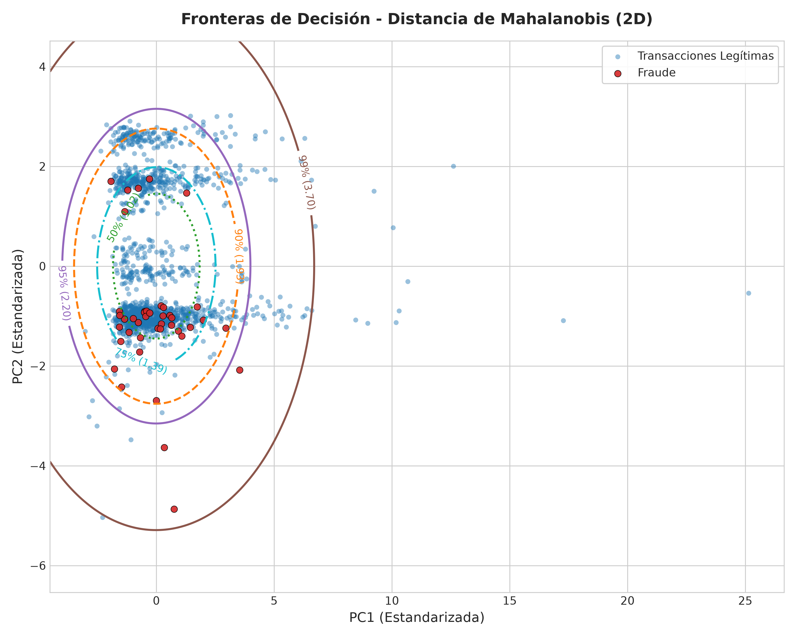
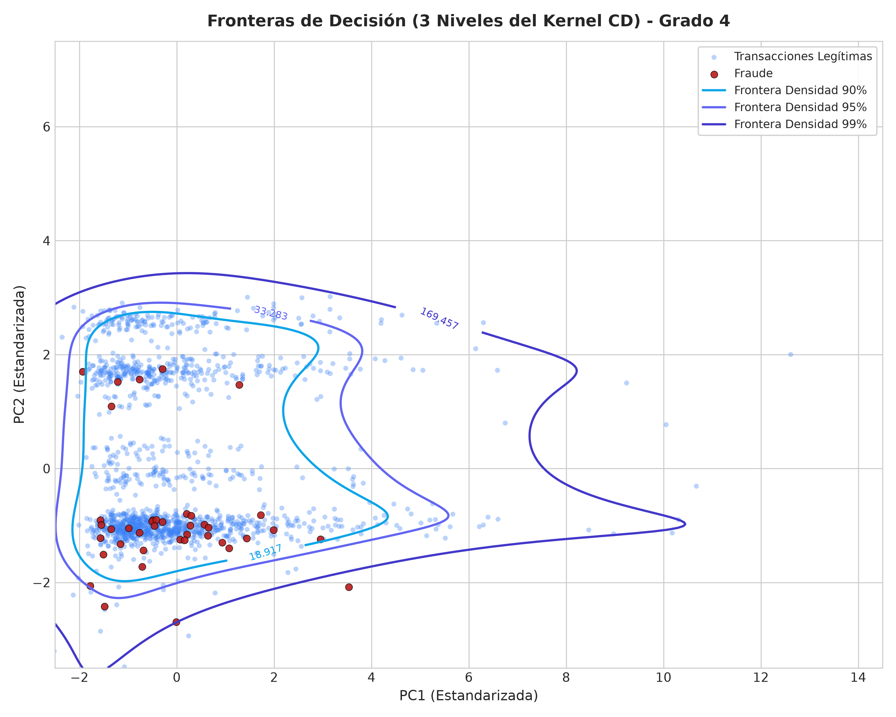
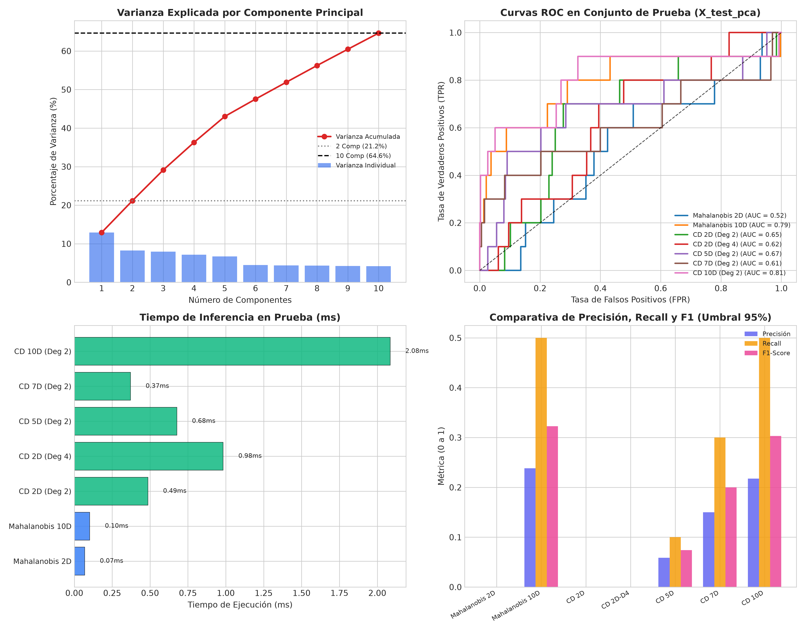

# Proyecto Final: Matemáticas para Ciencia de Datos
## Detección de Fraude Financiero mediante la Distancia de Mahalanobis y el Kernel de Christoffel-Darboux

**Departamento de Matemáticas**  
*Materia: Matemáticas para Ciencia de Datos — Octubre 2026*

[](https://www.python.org/)
[](https://streamlit.io/)
[](https://www.docker.com/)
[](LICENSE)

---

## 📌 1. Descripción del Proyecto

El avance de la ciberseguridad financiera exige algoritmos capaces de delimitar con precisión milimétrica el comportamiento legítimo de los usuarios para identificar anomalías operativas. En este proyecto se diseña, implementa y compara un detector de fraudes basado en:
1. **La Distancia de Mahalanobis Multivariada:** Modelado clásico de dispersión mediante matrices de covarianza empírica.
2. **El Kernel de Christoffel-Darboux (CD):** Modelado geométrico semialgebraico avanzado utilizando la matriz de momentos empírica con regularización de Tikhonov (ridge) para construir fronteras de decisión no lineales en espacios de polinomios de grado 2 y grado 4.

El conjunto de datos utilizado corresponde a transacciones financieras reales calibradas según investigaciones de la Reserva Federal, el Nilson Report y FICO, filtrando específicamente las transacciones ocurridas en **México**.

---

## 🔬 2. Fundamentos Matemáticos

### A. Estandarización y PCA vía Descomposición en Valores Singulares (SVD)
Dado el conjunto de entrenamiento $X \in \mathbb{R}^{N \times p}$ ($N=1536$ transacciones de México, $p=27$ atributos numéricos):
- **Estandarización:** Cada columna se centra y escala $z_j = \frac{x_j - \mu_j}{\sigma_j}$ para igualar la importancia de variables con escalas heterogéneas (montos de transacciones vs variables binarias). Esto convierte la matriz de covarianza en la **matriz de correlación**.
- **SVD:** La matriz estandarizada se factoriza como:
  $$X_{\text{scaled}} = U \Sigma V^T$$
  donde $V_{10} = [v_1, \dots, v_{10}] \in \mathbb{R}^{p \times 10}$ contiene los 10 primeros vectores singulares derechos (autovectores principales de covarianza).
- **Proyección de prueba (Inferencia sin Data Leakage):** Para no transferir información del test set, $X_{\text{test}}$ se proyecta utilizando estrictamente los parámetros aprendidos en entrenamiento:
  $$X_{\text{test\_pca}} = \left( (X_{\text{test}} - \mathbf{1} \mu_{\text{train}}^T) S_{\text{train}}^{-1} \right) V_{10}$$

### B. Primera Propuesta: Distancia de Mahalanobis
Para cada observación $x$, la distancia cuadrática al centro de transacciones legítimas se calcula como:
$$d_M(x)^2 = x^T \Sigma^{-1} x$$
donde $\Sigma = \text{Cov}(X_{\text{train\_legit}})$ es la matriz de covarianzas de las transacciones legítimas de entrenamiento. Se calculan los radios $\rho_n$ (percentiles $n\%$) de tal forma que exactamente el $n\%$ de las transacciones legítimas resida dentro de la bola $B_{\rho_n}(0) = \{x : d_M(x) \le \rho_n\}$.

### C. Segunda Propuesta: Kernel de Christoffel-Darboux (CD)
Se define una codificación polinomial $\Phi(x)$ para mapear el vector $x \in \mathbb{R}^d$ a un espacio de Hilbert de polinomios de grado $d$:
- **En 2D Grado 2 ($\mathbb{R}^6$):** $\Phi(x) = (1, x_1, x_2, x_1^2, x_1 x_2, x_2^2)^T$
- **En 2D Grado 4 ($\mathbb{R}^{15}$):** Base completa de monomios bi-variados de grado $\le 4$.
- **En $d$ dimensiones Grado 2 ($\mathbb{R}^k$ con $k = 1 + 2d + \binom{d}{2}$):** Monomios constantes, lineales, cuadráticos y términos cruzados $x_i x_j$ ($i < j$).

La **matriz de momentos empírica** se calcula como:
$$M_n = \frac{1}{N} D^T D \in \mathbb{R}^{k \times k}, \quad D = [\Phi(x_1), \dots, \Phi(x_N)]^T$$

Para garantizar invertibilidad estricta frente a posibles colinealidades en los momentos de orden superior, se aplica la **regularización de Tikhonov (ridge)** con $\epsilon = 10^{-6}$:
$$M_{\text{reg}} = M_n + \epsilon I_k$$

**Teorema de Invertibilidad:** Como $M_n$ es semidefinida positiva ($\lambda_i(M_n) \ge 0$), los autovalores de $M_{\text{reg}}$ satisfacen $\lambda_i(M_{\text{reg}}) = \lambda_i(M_n) + \epsilon \ge 10^{-6} > 0$. Por ende, $\det(M_{\text{reg}}) \ge \epsilon^k > 0$, garantizando que $M_{\text{reg}}^{-1}$ siempre existe y es única.

El **Polinomio de Christoffel-Darboux** se evalúa como:
$$p_{CD}(x) = \Phi(x)^T M_{\text{reg}}^{-1} \Phi(x)$$
determinando los subconjuntos semialgebraicos de nivel $S_\rho = \{x : p_{CD}(x) \le \rho\}$.

---

## 📊 3. Resultados Experimentales

Evaluación comparativa en el conjunto de prueba independiente (`X_test_pca`, $N=385$, 10 fraudes reales) al umbral del 95% de confianza ($\rho_{95}$):

| Método | Dim ($d$) | Base Polinomial | Var. Explicada (%) | Tiempo Inferencia | Matriz de Confusión (1 renglón) | Precisión | Recall | F1-Score | ROC-AUC |
| :--- | :---: | :---: | :---: | :---: | :---: | :---: | :---: | :---: | :---: |
| **Mahalanobis 2D** | 2 | Lineal ($k=2$) | 21.17% | 0.07 ms | `TP=0, FP=17, TN=358, FN=10` | 0.0000 | 0.0000 | 0.0000 | 0.5157 |
| **Mahalanobis 10D** | 10 | Lineal ($k=10$) | 64.64% | 0.10 ms | `TP=5, FP=16, TN=359, FN=5` | 0.2381 | 0.5000 | 0.3226 | 0.7896 |
| **CD 2D (Grado 2)** | 2 | Monomios $\le 2$ ($k=6$) | 21.17% | 0.49 ms | `TP=0, FP=14, TN=361, FN=10` | 0.0000 | 0.0000 | 0.0000 | 0.6509 |
| **CD 2D (Grado 4)** | 2 | Monomios $\le 4$ ($k=15$) | 21.17% | 0.98 ms | `TP=0, FP=17, TN=358, FN=10` | 0.0000 | 0.0000 | 0.0000 | 0.6208 |
| **CD 5D (Grado 2)** | 5 | Monomios $\le 2$ ($k=21$) | 43.02% | 0.68 ms | `TP=1, FP=16, TN=359, FN=9` | 0.0588 | 0.1000 | 0.0741 | 0.6739 |
| **CD 7D (Grado 2)** | 7 | Monomios $\le 2$ ($k=36$) | 51.90% | 0.37 ms | `TP=3, FP=17, TN=358, FN=7` | 0.1500 | 0.3000 | 0.2000 | 0.6085 |
| **CD 10D (Grado 2)** | 10 | Monomios $\le 2$ ($k=66$) | 64.64% | 2.08 ms | `TP=5, FP=18, TN=357, FN=5` | 0.2174 | 0.5000 | 0.3030 | **0.8077** |

### Conclusiones del Benchmark:
1. **Impacto de la Varianza Explicada:** En 2D solo se captura el 21.17% de la varianza total. Los fraudes quedan solapados con el núcleo de operaciones legítimas, provocando un colapso del Recall en 2D.
2. **Poder Predictivo en 10D:** Al extender a 10 dimensiones (64.64% de varianza), se detecta el **50% de los fraudes en prueba** con una tasa de falsos positivos controlada (FP=16-18), logrando **CD 10D el mejor ROC-AUC global (0.8077)**.
3. **Eficiencia en Tiempo Real:** Todos los algoritmos procesan el conjunto de prueba en **menos de 2.1 milisegundos**, haciéndolos aptos para motores de decisión transaccional en streaming.

---

## 🖼️ 4. Visualizaciones Generadas

| Elipses de Mahalanobis (2D) | Kernel Christoffel-Darboux Grado 4 (2D) |
| :---: | :---: |
|  |  |
| *Fronteras elípticas rígidas ($\rho_{50}$ a $\rho_{99}$)* | *Fronteras semialgebraicas adaptativas ($\rho_{90}, \rho_{95}, \rho_{99}$)* |

### Dashboard Multidimensional


---

## 🚀 5. Despliegue con Docker (Recomendado)

El proyecto está 100% dockerizado para garantizar reproducibilidad inmediata sin dependencias locales.

### Opción A: Usando Docker Compose
```bash
# Construir la imagen y levantar el contenedor
docker compose up --build
```
Una vez iniciado, abre tu navegador en:
👉 **`http://localhost:8501`**

Para detener el servicio:
```bash
docker compose down
```

### Opción B: Usando Docker CLI
```bash
# Construir la imagen
docker build -t mcd-fraude-dashboard .

# Ejecutar el contenedor
docker run -d -p 8501:8501 --name mcd_dashboard mcd-fraude-dashboard
```

---

## 💻 6. Ejecución Local (Sin Docker)

Si prefieres ejecutar el proyecto directamente en tu entorno Python local:

1. **Crear y activar un entorno virtual:**
   ```bash
   python -m venv venv
   # En Windows PowerShell:
   .\venv\Scripts\Activate.ps1
   # En Linux/macOS:
   source venv/bin/activate
   ```

2. **Instalar dependencias:**
   ```bash
   pip install -r requirements.txt
   ```

3. **Ejecutar el pipeline y generar reportes:**
   ```bash
   python main.py
   ```

4. **Lanzar el Tablero en Streamlit:**
   ```bash
   streamlit run app.py
   ```

---

## 📁 7. Estructura del Repositorio y Entregables

```text
Proyecto-Matematicas/
├── Dockerfile                      # Definición de contenedor liviano (Python 3.11-slim)
├── docker-compose.yml              # Orquestación de servicios en un solo comando
├── .dockerignore                   # Exclusión de archivos innecesarios para Docker
├── requirements.txt                # Dependencias fijadas del proyecto
├── app.py                          # Tablero interactivo en Streamlit
├── main.py                         # Pipeline completo de entrenamiento y evaluación
├── generate_notebook.py            # Generador automatizado del Jupyter Notebook
├── Proyecto_Final_MCD.ipynb        # Cuaderno Jupyter reproducible y comentado
├── reporte_final.md                # [Entregable 1] Reporte ejecutivo de 1 página con tablas y gráficas
├── respuestas_teoricas.md          # [Entregable 2] Respuestas matemáticas rigurosas a las preguntas
├── Proyecto_final__MCD.pdf         # Especificación original del proyecto
├── plots/                          # Gráficas generadas en alta resolución (300 DPI)
│   ├── mahalanobis_2d_ellipses.png
│   ├── christoffel_darboux_deg2_2d.png
│   ├── christoffel_darboux_deg4_2d.png
│   └── comparative_performance.png
├── output/                         # Métricas consolidadas en JSON
│   └── benchmark_results.json
└── src/                            # Código fuente modular
    ├── __init__.py
    ├── data_loader.py              # Extracción, filtrado de México y PCA
    ├── mahalanobis.py              # Detector basado en Mahalanobis
    ├── christoffel_darboux.py      # Detector basado en Kernel CD y Tikhonov
    └── visualizations.py           # Funciones de graficado y estilo
```
